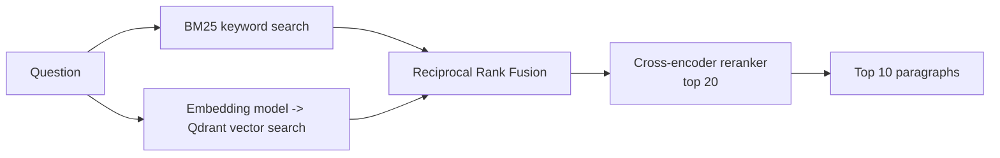

# Retrieval evaluation: BM25, vectors, fusion and reranking

[](https://github.com/VasilenData/rag-retrieval-eval/actions/workflows/ci.yml)
[](LICENSE)

The retrieval half of a RAG (retrieval-augmented generation) system, built and **measured** instead of assumed. Four retrieval strategies are compared on the same 2,000 labelled questions, with confidence intervals, latency and examples of failures.



## Setup

* **Corpus:** 2,067 paragraphs from 48 Wikipedia articles, and **10,570 questions** each written about one paragraph: the [SQuAD v1.1 dev set](https://rajpurkar.github.io/SQuAD-explorer/) (CC BY-SA 4.0). The paragraph a question was written about is the ground-truth answer to "which document should be retrieved?".
* **Sample:** 2,000 questions drawn with a fixed random seed.
* **Systems:** BM25 (`rank-bm25`); dense search with `BAAI/bge-small-en-v1.5` embeddings in **Qdrant**; hybrid fusion of the two with Reciprocal Rank Fusion; hybrid plus a cross-encoder reranker (`ms-marco-MiniLM-L-6-v2`) on the top 20. Embeddings and reranking run through `fastembed` (ONNX, CPU only).
* **Metrics:** recall@k (is the right paragraph in the top k?) and MRR@10, with a bootstrap 95% confidence interval on recall@1.

## Results

| System | Recall@1 | Recall@5 | Recall@10 | MRR@10 | Latency per query |
|---|---:|---:|---:|---:|---:|
| BM25 | 76.3% (74.5 to 78.1) | 91.4% | 94.4% | 0.828 | 2 ms |
| Dense vectors (Qdrant) | 69.4% (67.4 to 71.4) | 89.5% | 94.0% | 0.780 | 3 ms |
| Hybrid (BM25 + dense, RRF) | 77.0% (75.3 to 78.9) | 94.0% | 97.3% | 0.844 | 5 ms |
| **Hybrid + rerank top 20** | **86.3%** (84.8 to 87.8) | **97.2%** | **98.4%** | **0.911** | 99 ms |

Brackets are the 95% confidence interval for recall@1. Full numbers: [results/metrics.json](results/metrics.json).

## What this shows

1. **Keyword search beat vector search at the top spot.** BM25 got the right paragraph first 76% of the time against 69% for embeddings. That is not what most tutorials suggest, and it makes sense here: the questions were written while looking at the paragraph, so they share rare words with it. Measure on your own data before choosing a vector database.
2. **Fusion helps most at 10 results, not at 1.** Hybrid raised recall@10 from 94.4% to 97.3%, but its recall@1 (77.0%) is within the confidence interval of BM25's (76.3%), so I would not claim a top-1 gain.
3. **The reranker is the one large, clearly significant gain**: recall@1 from 77% to 86%, with confidence intervals that do not overlap. The cost is latency, about 99 ms per question against 5 ms, because a cross-encoder reads each question together with 20 candidate paragraphs.
4. **Where it still fails:** the report lists sample failures. In the 8 failures sampled in `metrics.json`, 7 had the correct paragraph among the 20 candidates, so the remaining errors are mostly about ordering, not about finding candidates. Many are near-duplicates, for example two paragraphs from the same article about the same topic.

## Limits, stated plainly

* **Retrieval only.** There is no language model in this repository, so answer quality and hallucination are not evaluated. The retriever is the part you would plug into one.
* **A small, clean corpus.** 2,067 paragraphs is far easier than millions of messy documents, and the questions were written with the paragraph in view, which favours keyword matching. Treat the absolute numbers as specific to this dataset.
* **Query embedding was done in one batch**, so the dense and hybrid latencies amortise it. A single live query would cost more for that step.
* Latencies are from a cloud VM on CPU and will differ on other hardware.
* The index is rebuilt in memory on every run (about 26 seconds for the embeddings). A production system would persist it.

## Run it

```bash
pip install -r requirements.txt
PYTHONPATH=src python -m ragkit.evaluate --n 2000      # downloads the data and models, writes results/metrics.json
pytest -q                                              # unit tests for metrics, fusion, BM25 and data handling
```

`src/ragkit/` holds the pieces: `retrievers.py` (the three retrievers), `fusion.py` (RRF), `metrics.py` (recall, MRR, bootstrap), `evaluate.py` (the experiment).
